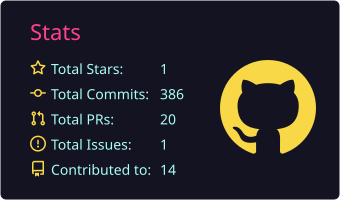
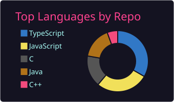
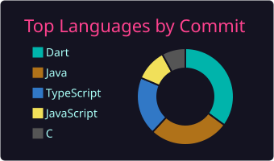

<h1 align="center"><b>Hey, I'm Farouk Ben Taleb</b></h1>

  

  

### 🙋‍♂️ **About Me**

- 🎓 Final-year **Software Architecture Engineering** student at [ESPRIT](https://esprit.tn) (Tunisia), with an exchange semester at **Polytech Nice Sophia Antipolis**.
- 💼 Full stack development intern at **Food4Future** (Spiraw), Jun–Aug 2026.
- 🔭 I build products end to end, always with an **AI module** fitted to the context, from small chatbots to large LLMs.
- 🌱 I’m learning **RAG & LLM systems**, **Application Security**, and **Advanced Backend Systems**.
- 🔎 Open to a **6-month internship from January 2027**.
- 💬 Ask me about **Web Development**, **AI integration**, and **IT Security**.
- 🏆 Participated in **"Bal des Projets"** with the “5adamni” Job-Seeking Platform.
- 🌐 Portfolio: [faroukbentaleb.me](https://faroukbentaleb.me)
- ⚡ Fun fact: I love gaming, anime, and playing football with friends.

   
## <b> Skills</b>

#### Languages

#### Frontend Development

#### Backend & Architecture

#### AI & LLM

#### Mobile & Desktop Development

#### Databases & Security

#### DevOps & Tools

   

## <b> Projects </b>

#### 1. Spiraw Booth Experience & Spiraw Quiz (Food4Future internship)
An interactive trade show platform (web + mobile) that turns booth visits into games, points, rewards and leads. I developed Spiraw Quiz in full during my internship.

**Key Features:**
- 🎮 Game categories: Knowledge (Hangman, Quiz, Product Puzzle), Fun & Luck, and 1v1 Duels.
- 🪙 Points system, merchandise shop, referrals and a jackpot draw.
- 🔐 JWT authentication (HttpOnly cookies), 2FA, admin analytics dashboard.
- 🐳 Containerised with Docker Compose (frontend, backend, games, PostgreSQL).

**Skills:** React, Vite, Tailwind CSS, Node.js, Express.js, PostgreSQL, Flutter, Three.js, Docker, JWT

---

#### 2. [Khet 2.0 – 3D Laser Chess](https://github.com/FaroukBentaleb/ps8-26-finalmove)
A full-stack multiplayer recreation of the classic Laser Chess game featuring modern 3D graphics and a scalable microservices architecture.

**Key Features:**
- ♟️ Interactive 3D chess board built with Three.js.
- 🔫 Real-time laser physics, reflections, and animations.
- 🌐 Online multiplayer using WebSockets.
- 🏗️ Frontend and backend developed with a microservices architecture.
- 📱 Mobile application version available.
- ☁️ Deployed on AWS EC2 with HTTPS.
- 🚀 Production deployment: https://finalmove.ps8.pns.academy/

**Skills:** Three.js, React.js, Node.js, JavaScript, WebSockets, Microservices, REST APIs, Docker, AWS, Git

---

#### 3. [JungleInEnglish – Academic Management Platform](https://github.com/FaroukBentaleb/Esprit-PI-4SAE2-2026-JungleInEnglish)
A full-stack enterprise platform for English language schools built using Spring Boot and Angular with a microservices architecture (team of 6). I built the **Complaints** and **Forum** modules.

**Key Features:**
- 📚 Course management.
- 📝 Exam management.
- 🏆 Competition management.
- 🎯 Club management.
- 🌍 Student mobility management.
- 🤖 AI-powered complaint management.
- 🔐 OAuth2, Keycloak & JWT authentication.
- ⚙️ Seven independent microservices.

**Skills:** Spring Boot, Angular, Java, Spring Security, Keycloak, OAuth2, JWT, Microservices, Docker, MySQL, REST APIs, Git

---

#### 4. DevAssist Hub – AI for Software Engineering (team ByteQuest)
A web platform for developers with five AI-powered modules (commits, code snippets, bug reports, SQL queries, code reviews), one module per team member. I built the **Commits** module.

**Key Features:**
- 🤖 LLM served through Hugging Face.
- 🔎 RAG pipeline with a Qdrant vector database.
- ⚙️ Full stack CRUD module with its own database.

**Skills:** Spring Boot, Angular, PostgreSQL, Hugging Face, Qdrant, RAG, Docker

---

#### 5. Kickoff – Football Matches with Friends
A gamified Flutter app to organise football matches: create a match, pick the stadium, then make it public or share a private code with friends.

**Skills:** Flutter, Dart, Dart Shelf, SQLite

---

#### 6. [CodeArena - Competitive Programming Platform](https://github.com/FaroukBentaleb/CodeArena)
A competitive programming platform inspired by Codeforces.

**Key Features:**
- 💻 Online programming contests.
- 📋 Programming problem management.
- ⚡ Multi-language code execution.
- 👨‍💼 Admin dashboard for contests and users.

**Skills:** Next.js, React.js, Node.js, Express.js, JavaScript, MongoDB, Git

---

#### 7. [Learniverse - Cross-Platform E-Learning Platform](https://github.com/FaroukBentaleb/Learniverse)
A secure, cross-platform e-learning platform for students and teachers.

**Key Features:**
- 🔐 Secure authentication with 2FA and OAuth (Google/GitHub).
- 📱 Cross-platform support using Symfony (Web), JavaFX (Desktop), and FlutterFlow (Mobile).
- 🖥️ Advanced session management with device, IP, and location tracking.
- 🛡️ Password recovery and account lockout protection.
- 👥 Interactive forums and complaint management.
- ⚙️ Administrative dashboard for user moderation.

**Skills:** Symfony, JavaFX, FlutterFlow, PHP, MySQL, Firebase, Java, Git

---

#### 8. [5adamni - Job Finder Website](https://github.com/FaroukBentaleb/5adamni)  
A job-seeking platform tailored for Tunisia. Features include:  
- Job search, chatbot, and community chat.
- Profile customization and CV creation.
- Interview scheduling and problem resolution systems.

#### 9. [ReEarth - Smart Recycling Center](https://github.com/FaroukBentaleb/ReEarth)  
A smart recycling center desktop application developed using **Qt C++**.  
- Automates sorting and management of recyclable materials.  
- Tracks data for waste management and environmental monitoring.  
- User-friendly interface for administrators.

#### 10. [SMEDS (*Shadow Manuscript Esprit Dark Secret*)](https://github.com/FaroukBentaleb/SMEDS-2D-game)  
A 2D mystery-adventure game developed with **SDL C**.  
- Immersive story and puzzle-solving gameplay.  
- Dynamic environments with interactive shadow mechanics.  
- Built from scratch with a focus on creative design.

   

## <b> Github Stats </b>

  
  

  
  

   
### 🌐 **Connect with Me**

  
  
  
  

   

### 💡 **Random Dev Quote**

   

### 📜 **Credit**

Credit: [Farouk Ben Taleb](https://github.com/FaroukBentaleb)  
Last Edited on: 30/10/2026
